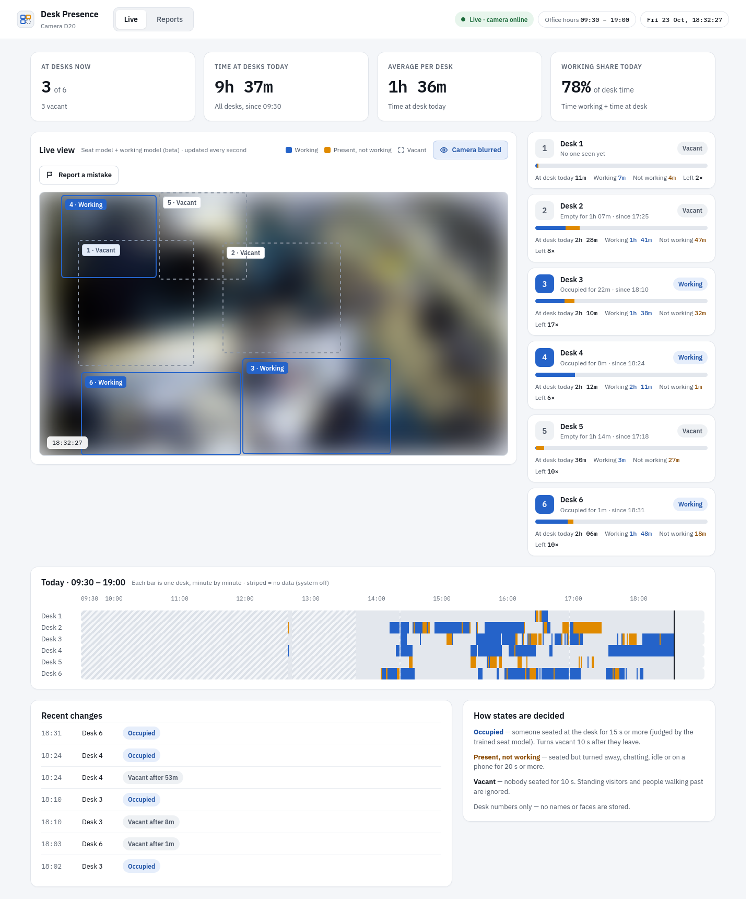
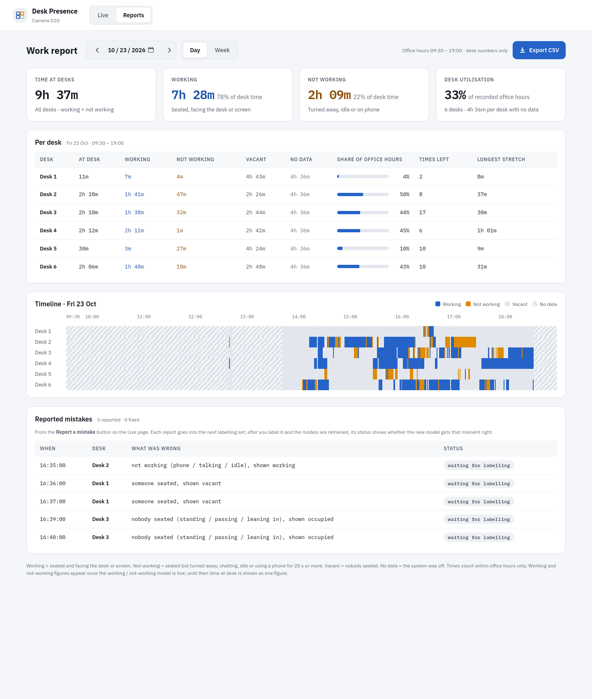
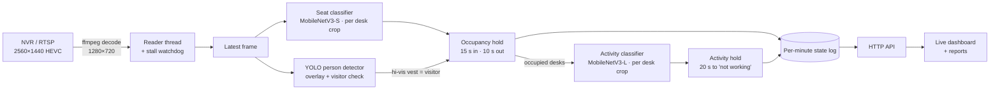
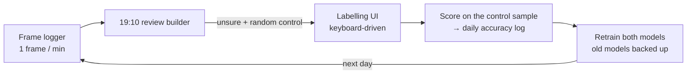

# SeatSense

[](https://github.com/devanshsingh0704/seatsense/actions/workflows/tests.yml)

**Real-time workspace occupancy and activity analytics from an existing CCTV camera.**

SeatSense watches one office camera and answers, for every desk, minute by minute: *is someone
seated here, and are they working?* It turns that into a live dashboard and daily or weekly
per-desk reports. It improves through a daily human-in-the-loop cycle: the model picks the
frames it is unsure about, a person labels them, and the next model is trained and scored on
data it has never seen.

It runs on one GPU workstation next to the NVR. No cloud and no stored video: only one
state per desk per minute.



---

## What it does

| | |
|---|---|
| **Seat occupancy** | Each desk is *occupied* only when someone is **seated** there. Standing, walking past, leaning in from the next desk, or a visitor all count as vacant. |
| **Activity** *(beta)* | For occupied desks: **working**, or **present but not working** (on the phone, talking or turned away, idle). |
| **Live dashboard** | Camera view with state-coloured desk boxes, desk cards, today's timeline, events. |
| **Reports** | Per desk, by day or week: time at desk, time working, time not working, vacant, number of departures, longest stretch, timeline. CSV export. |
| **Daily learning loop** | Uncertainty sampling, labelling UI, honest daily accuracy, retraining with rollback. |

The Reports page: day and week per desk, the timeline, and the mistakes users reported from the
live view with how far each has got (labelled, retrained, fixed).



## Architecture



Design points:

- **A classifier per desk, not "a person box inside a desk box".** Geometry alone couldn't separate
  a seated person from someone standing in front of the desk. From an elevated camera both
  overlap the box by 77–85%. A small CNN on each desk crop learns what "this chair is in use"
  looks like, even when the person is half hidden by a monitor or turned away.
- **Hysteresis everywhere.** One wrong frame never changes a desk. A desk becomes *occupied* after
  15 s of continuous sitting, with gaps of up to 3 s tolerated, and *vacant* 10 s after the
  person leaves. *Not working* needs 20 s, so a glance at a phone never counts.
- **Missing data is "no data", never "vacant".** If the camera or detector is down, those
  minutes are left empty in the reports, so nobody is shown as absent when the system was blind.
- **Pull-based video.** The browser asks for the next frame only after showing the previous one.
  This replaced push MJPEG, whose backlog over an SSH tunnel had grown to 40 s of lag; now it is about 2 s.

## Models and results

All numbers are from **4-fold cross-validation split by half-hour blocks of the day**, so
neighbouring, near-identical frames never sit on both sides of the split. Every number is from
the final epoch; the best epoch is never cherry-picked.

### Seat occupancy: is someone seated at this desk?

MobileNetV3-Small, fine-tuned from ImageNet, shared across all desks. Input: the desk box plus a
10% margin, letterboxed to 224 px.

| Method | Accuracy (per desk-frame) |
|---|---|
| Person box ≥ 85% inside desk box (rule) | 95.8% |
| **Seat classifier** | **98.1%** |

Measured on a full labelled working day. The classifier cut missed sitters from 112 to 27. Its
remaining errors were mostly neighbours leaning into an adjacent desk box. A targeted round of
labelling on exactly those cases cut false alarms at the worst desk **from 32 to 3**, with no
regression on the original day.

### Activity: working or not? *(beta)*

MobileNetV3-Large on the desk crop, plus a 15% margin, letterboxed to 320 px. Trained at the
resolution the live system actually sees, 1280×720. 1,443 hand-labelled seated-person crops.

| | |
|---|---|
| Overall accuracy | **86.7%** |
| Working recognised | 91.3% |
| Not working caught | 74.4% |
| On the phone / talking / idle caught | 74% / 70% / 81% |

The hard part is the "not working" class: a phone held low behind a monitor, or a short
conversation, is hard to tell from working at this camera distance. This is what the daily loop
is for.

### Beyond accuracy

Full tables: [`docs/evaluation.md`](docs/evaluation.md), generated by `tools/evaluate.py` from the
held-out predictions (CPU only, no retraining). What it shows that accuracy hides:

- **The business number.** Over a full labelled day (1,080 seated minutes), the seat model's
  minutes-at-desk error is **28 min (2.6%)**, against 120 min (11.1%) for the box rule.
- **Per-desk weak spots.** Accuracy is inflated by easy vacant frames. Desk 5 reads 95.7%
  accurate but finds only **42% of the people seated there** (F1 0.50); for activity, desks 4
  and 6 sit near F1 0.53. These are the next labelling targets.
- **Calibration.** Both models are over-confident: temperature scaling, fitted only on other
  folds, finds T ≈ 1.9 (seat) and T ≈ 3.3 (activity) and cuts the activity model's expected
  calibration error from 0.106 to 0.045. This matters for the review builder, which picks
  "unsure" samples by probability.
- **Threshold.** There is no free lunch on "not working": raising the threshold from 0.5 to 0.9
  lifts precision only from 76% to 81% while recall falls from 74% to 63%. More data, not a
  different threshold, is the fix.
- **Generalisation to a new day.** `--cv --by-day` holds out whole days instead of half-hours,
  the honest test for a new Monday ([`docs/new-day-test.md`](docs/new-day-test.md)). The seat
  model holds up (96.8% on unseen days vs 97.8% within-day), but the activity model drops from
  86.7% to about 82%, so the within-day number was optimistic. Adding one labelled day improved
  every held-out day for both models, which is the case for the daily loop.

## The daily human-in-the-loop cycle



1. **Collect.** One full-resolution frame per minute during office hours, with the live system's answer.
2. **Select.** Every evening the review builder picks:
   - **Uncertain** samples: seat minutes with a score between 0.05 and 0.95, and activity crops
     closest to 50/50.
   - **Known weak spots**, such as desks whose boxes overlap in the picture.
   - **A random control sample**, chosen without looking at the model.

   If the live system was down, its missing answers are filled in by running the same model
   afterwards.
3. **Label.** Two small local web UIs driven by single keys. Seat frames are pre-filled with the
   model's answer, so most of the work is confirming.
4. **Score.** Accuracy is computed **only on the random control sample** from a day the model has
   never trained on. That is the honest number, logged day by day, so the effect of each retrain
   is visible.
5. **Retrain.** Both models are retrained on everything labelled so far. The previous models are
   kept, so a worse day can be rolled back.

## What didn't work (and why)

| Idea | Result |
|---|---|
| **Pose keypoints to veto standing people** | Rejected. Desks and partitions hide the legs: even a clearly standing person had knee confidence 0.19. The best version removed 3 false alarms but added up to 30 misses. |
| **Zero-shot COCO "cell phone" for phone use** | Rejected. It finds phones in hand (0.7–0.9), but scores the same on an AC remote, phones lying on desks and boxes. Replaced by the trained activity classifier. |
| **"Is the chair empty?" check** | Rejected. From these angles a seated person hides their own chair completely (0.00 overlap). |
| **Tuning box geometry** | Plateaued. Seated and standing overlaps share the 0.77–0.85 range; no threshold separates them. This is what led to the per-desk classifier. |
| **Full-resolution crops for the activity model** | Rejected. On unseen days, crops cut from the 2560×1440 frame scored 77.7% vs 81.2% at 720p: phones were not caught more often (153 vs 151 of 216), and working people were wrongly flagged more (precision 58% vs 66%). |
| **A single train/test split** | Gave an inflated 96.2% from picking the best epoch on the test set. Replaced by time-blocked 4-fold CV with final-epoch scores. |

## Reliability

- **Stalled-stream watchdog.** An RTSP stream can die without closing, which leaves the decoder
  blocked forever while the service still looks healthy. This once froze the system for four
  days. A watchdog now kills the decoder after 15 s without a frame, and the reader reconnects
  with backoff.
- **Hard timeouts in the frame logger.** Its frame grabs and status probes cannot hang the
  minute loop.
- **Tested logic.** The hold rules, report maths, review selection, daily scoring, labelling
  validation and training-data assembly are covered by unit tests.

## Project layout

```
live.py            live service: capture, inference, state, HTTP API + dashboard
presence.py        desk boxes, occupancy hold (hysteresis)
seat.py            seat classifier runtime
activity.py        activity classifier runtime + "not working" hold
vest.py            visitor detection (hi-vis vest colour on the torso)
watchdog.py        kills a stalled decoder
report.py          day / week reports from the per-minute state log
web/               live dashboard and reports pages
tools/
  mark_boxes.py    draw the desk boxes on a camera frame
  frame_logger.sh  one frame per minute for the dataset
  daily.py         daily review set + daily accuracy score
  review_set.py    uncertainty / weak-spot / control selection
  label*.py/.html  labelling UIs
  train_seat.py    seat classifier training (+ --cv)
  train_activity.py activity classifier training (+ --cv, --res 720|full)
  retrain.sh       back up and retrain both models
zones/             desk boxes per camera (pixel coordinates on the main stream)
```

## Running it

**Requirements:** Python 3.10+, an NVIDIA GPU, ffmpeg, then `pip install -r requirements.txt`.

1. Create `.env` (never committed):
   ```
   NVR_HOST=<nvr address>
   NVR_USER=<user>
   NVR_PASS=<password>
   CAMERA_NAME=<label shown on the dashboard>   # optional
   ```
2. Mark the desk boxes on a frame with people seated:
   `python3 tools/mark_boxes.py d20 <frame.jpg>`
3. Collect and label data, then train:
   - `tools/frame_logger.sh`
   - `python3 tools/label.py <day>`
   - `python3 tools/train_seat.py <day> [<day> ...]`
   - `python3 tools/train_activity.py recordings/activity --res 720`

   Add `--cv` to either training script for the honest cross-validated score.
4. Start the service:
   - `python3 live.py`
   - open `http://localhost:8095` for the live view and `/reports` for the reports.

   The server listens on localhost only; reach it from another machine through an SSH tunnel.

Trained weights, recordings and labels are **not** in this repository; see Privacy below.

## Privacy

Built for a deployment where staff were informed and HR owns the data.

- **No video is stored** by the live system, only one state per desk per minute.
- **Reports show desk numbers, not names.**
- Training frames stay on the local machine. Camera images, labels, attendance logs and trained
  weights are excluded from this repository.

## Licence

**AGPL-3.0** (see `LICENSE`), because the person detector uses Ultralytics YOLO, which is AGPL-3.0.
The seat and activity classifiers use TorchVision MobileNetV3 (BSD). A closed-source deployment
would swap the detector for a permissively licensed one (for example RF-DETR, Apache-2.0).
