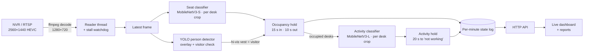
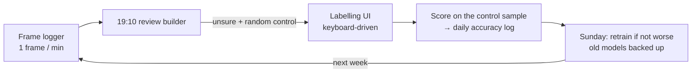

# SeatSense

[](https://github.com/devanshsingh0704/seatsense/actions/workflows/tests.yml)


**Real-time workspace occupancy and activity analytics from an existing CCTV camera.**

SeatSense watches one office camera and answers, for every desk, minute by minute: *is someone
seated here, and are they working?* It turns that into a live dashboard and daily or weekly
per-desk reports. It improves through a daily human-in-the-loop cycle: the model picks the
frames it is unsure about, a person labels them, and the next model is trained and scored on
data it has never seen.

It runs on one GPU workstation next to the NVR. No cloud and no stored video: the reports keep
one state per desk per minute, and the learning loop one camera frame per minute, deleted after
14 days unless it was picked for labelling.


**Contents:** [What it does](#what-it-does) · [Architecture](#architecture) · [Models and results](#models-and-results) ·
[The daily learning loop](#the-daily-human-in-the-loop-cycle) · [What didn't work](#what-didnt-work-and-why) ·
[Security](#security) · [Project layout](#project-layout) · [Quick start](#quick-start) ·
[Operations](#operations) · [Privacy](#privacy) · [Licence](#licence)

For the reasoning behind each design decision, the rules of the deployment and what not to break,
see [`CONTEXT.md`](CONTEXT.md).

---

## What it does

| | |
|---|---|
| **Seat occupancy** | Each desk is *occupied* only when someone is **seated** there. Standing, walking past, leaning in from the next desk, or a visitor all count as vacant. |
| **Activity** *(beta)* | For occupied desks: **working**, or **present but not working** (on the phone, talking or turned away, idle). |
| **Live dashboard** | Camera view with state-coloured desk boxes, desk cards, today's timeline, events. |
| **Reports** | Per desk, by day or week: time at desk, time working, time not working, vacant, number of departures, longest stretch, timeline. CSV export. |
| **Daily learning loop** | Uncertainty sampling, labelling UI, honest daily accuracy, retraining with rollback. |

The Reports page: day and week per desk, the timeline, and the mistakes users reported from the
live view with how far each has got (labelled, retrained, fixed).


## Architecture



Design points:

- **A classifier per desk, not "a person box inside a desk box".** Geometry alone couldn't separate
  a seated person from someone standing in front of the desk. From an elevated camera both
  overlap the box by 77–85%. A small CNN on each desk crop learns what "this chair is in use"
  looks like, even when the person is half hidden by a monitor or turned away.
- **Hysteresis everywhere.** One wrong frame never changes a desk. A desk becomes *occupied* after
  15 s of continuous sitting, with gaps of up to 3 s tolerated, and *vacant* 10 s after the
  person leaves. *Not working* needs 20 s, so a glance at a phone never counts.
- **Missing data is "no data", never "vacant".** If the camera or detector is down, those
  minutes are left empty in the reports, so nobody is shown as absent when the system was blind.
- **Two thresholds, chosen on unseen days.** A free desk is taken only when the seat model is at
  least 75% sure; a taken desk is kept while it stays above 50%. On leave-one-day-out tests every
  fold chose 0.75, cutting false "sitting" (people standing or leaning in) from 121 to 79. "Not
  working" is flagged from 0.7, which cut wrong flags by a quarter without losing real catches on
  the daily check samples.
- **Pull-based video.** The browser asks for the next frame only after showing the previous one.
  This replaced push MJPEG, whose backlog over an SSH tunnel had grown to 40 s of lag; now it is about 2 s.

## Models and results

All numbers are from **4-fold cross-validation split by half-hour blocks of the day**, so
neighbouring, near-identical frames never sit on both sides of the split. Every number is from
the final epoch; the best epoch is never cherry-picked.

### Seat occupancy: is someone seated at this desk?

MobileNetV3-Small, fine-tuned from ImageNet, shared across all desks. Input: the desk box plus a
10% margin, letterboxed to 224 px.

| Method | Accuracy (per desk-frame) |
|---|---|
| Person box ≥ 85% inside desk box (rule) | 95.8% |
| **Seat classifier** | **98.1%** |

Measured on a full labelled working day. The classifier cut missed sitters from 112 to 27. Its
remaining errors were mostly neighbours leaning into an adjacent desk box. A targeted round of
labelling on exactly those cases cut false alarms at the worst desk **from 32 to 3**, with no
regression on the original day.

### Activity: working or not? *(beta)*

MobileNetV3-Large on the desk crop, plus a 15% margin, letterboxed to 320 px. Trained at the
resolution the live system actually sees, 1280×720. 1,443 hand-labelled seated-person crops.

| | |
|---|---|
| Overall accuracy | **86.7%** |
| Working recognised | 91.3% |
| Not working caught | 74.4% |
| On the phone / talking / idle caught | 74% / 70% / 81% |

The hard part is the "not working" class: a phone held low behind a monitor, or a short
conversation, is hard to tell from working at this camera distance. This is what the daily loop
is for.

### Beyond accuracy

Full tables: [`docs/evaluation.md`](docs/evaluation.md), generated by `training/evaluate.py` from the
held-out predictions (CPU only, no retraining). What it shows that accuracy hides:

- **The business number.** Over a full labelled day (1,080 seated minutes), the seat model's
  minutes-at-desk error is **28 min (2.6%)**, against 120 min (11.1%) for the box rule.
- **Per-desk weak spots.** Accuracy is inflated by easy vacant frames. Desk 5 reads 95.7%
  accurate but finds only **42% of the people seated there** (F1 0.50); for activity, desks 4
  and 6 sit near F1 0.53. These are the next labelling targets.
- **Calibration.** Both models are over-confident: temperature scaling, fitted only on other
  folds, finds T ≈ 1.9 (seat) and T ≈ 3.3 (activity) and cuts the activity model's expected
  calibration error from 0.106 to 0.045. This matters for the review builder, which picks
  "unsure" samples by probability.
- **Threshold.** There is no free lunch on "not working": raising the threshold from 0.5 to 0.9
  lifts precision only from 76% to 81% while recall falls from 74% to 63%. More data, not a
  different threshold, is the fix.
- **Generalisation to a new day.** `--cv --by-day` holds out whole days instead of half-hours,
  the honest test for a new Monday ([`docs/new-day-test.md`](docs/new-day-test.md)). The seat
  model holds up (96.8% on unseen days vs 97.8% within-day), but the activity model drops from
  86.7% to about 82%, so the within-day number was optimistic. Adding one labelled day improved
  every held-out day for both models, which is the case for the daily loop.

## The daily human-in-the-loop cycle



1. **Collect.** One full-resolution frame per minute during office hours, with the live system's answer.
2. **Select.** Every evening the review builder fills a fixed budget (90 seat frames and 60 activity
   crops, about 30 minutes of labelling) from:
   - **Uncertain** samples: seat minutes with a score between 0.05 and 0.95, and activity crops
     closest to 50/50.
   - **Known weak spots**, such as desks whose boxes overlap in the picture.
   - **A random control sample**, chosen without looking at the model.

   Reported mistakes and the control are always kept. A day that was not labelled in time is cut
   down to just those (`training/daily.py backlog <day>`), so its honest score is still possible.

   If the live system was down, its missing answers are filled in by running the same model
   afterwards.
3. **Label.** Two small local web UIs driven by single keys. Seat frames are pre-filled with the
   model's answer, so most of the work is confirming.
4. **Score.** Accuracy is computed **only on the random control sample** from a day the model has
   never trained on. That is the honest number, logged day by day, so the effect of each retrain
   is visible.
5. **Retrain, gated, every Sunday** (`scripts/weekly.sh`). Candidates are trained without the newest
   labelled day, then they and the live models are scored on that day's control sample, which
   neither has seen. A candidate at least as good as the live model goes live as it is, so what
   runs is exactly what was tested; the held-out day joins the training data the next week. With
   fewer than 100 seat checks or 20 activity crops labelled in the control, the live model stays.
   Nothing new labelled, a busy GPU or a failed training all leave the live models untouched.
   Decisions go to `models/retrain_log.jsonl`; the replaced models go to `models/history/`, and
   `scripts/rollback.sh [stamp]` puts them back.

## What didn't work (and why)

| Idea | Result |
|---|---|
| **Pose keypoints to veto standing people** | Rejected. Desks and partitions hide the legs: even a clearly standing person had knee confidence 0.19. The best version removed 3 false alarms but added up to 30 misses. |
| **Zero-shot COCO "cell phone" for phone use** | Rejected. It finds phones in hand (0.7–0.9), but scores the same on an AC remote, phones lying on desks and boxes. Replaced by the trained activity classifier. |
| **"Is the chair empty?" check** | Rejected. From these angles a seated person hides their own chair completely (0.00 overlap). |
| **Tuning box geometry** | Plateaued. Seated and standing overlaps share the 0.77–0.85 range; no threshold separates them. This is what led to the per-desk classifier. |
| **Full-resolution crops for the activity model** | Rejected. On unseen days, crops cut from the 2560×1440 frame scored 77.7% vs 81.2% at 720p: phones were not caught more often (153 vs 151 of 216), and working people were wrongly flagged more (precision 58% vs 66%). |
| **A single train/test split** | Gave an inflated 96.2% from picking the best epoch on the test set. Replaced by time-blocked 4-fold CV with final-epoch scores. |

## Reliability

- **Stalled-stream watchdog.** An RTSP stream can die without closing, which leaves the decoder
  blocked forever while the service still looks healthy. This once froze the system for four
  days. A watchdog now kills the decoder after 15 s without a frame, and the reader reconnects
  with backoff.
- **Hard timeouts in the frame logger.** Its frame grabs and status probes cannot hang the
  minute loop.
- **Tested logic.** The hold rules, report maths, review selection, daily scoring, labelling
  validation and training-data assembly are covered by unit tests.

## Security

The dashboard holds camera views of employees and HR data, so it is built to be safe on an office network:

| | |
|---|---|
| **Sign-in** | Accounts are created on the server (`python3 -m scripts.users add NAME [--camera]`). Passwords are stored only as salted scrypt hashes; the sign-in pass is a random 8-hour token in an HttpOnly, Secure, SameSite=Strict cookie. |
| **Brute force** | 5 wrong passwords lock that account for 15 minutes; 20 failures from one computer block that computer for 15 minutes. The error message never reveals whether an account exists, and unknown names take as long to check as real ones. |
| **Camera access** | Per account, enforced by the server: without permission the camera picture is refused (403), not just hidden. The view starts blurred even for permitted accounts. |
| **Encryption** | HTTPS (TLS 1.2+) whenever a certificate is present (`scripts/make_cert.sh <ip>`); plain HTTP on the same port only ever gets a redirect to HTTPS and is never processed. Without a certificate the server stays on 127.0.0.1. |
| **Browser** | Content-Security-Policy (own scripts and data only), no framing, no access to the visitor's camera, microphone or location. |
| **Audit** | Every sign-in, failure, lockout and sign-out goes to `logs/access.log` (owner-only, like the accounts file and the certificate key). |
| **Repository** | `scripts/privacy_check.py` refuses data files, keys, tokens, password hashes, credentials in URLs, private IP addresses, e-mail addresses, home paths and unreviewed images, plus (locally) every `.env` value and a private word list. It checks commit messages and author e-mails too. It runs on every push in CI (every file, message and author in the history) with the Bandit security linter, and before every commit once the hooks are enabled: `git config core.hooksPath .githooks`. Model weights load with `weights_only=True`, so a tampered weights file cannot run code. |

## Project layout

```
seatsense/            the live service (python3 -m seatsense.app)
  app.py              capture, inference, desk state, HTTP API, sign-in, HTTPS
  presence.py         desk boxes and the occupancy hold (hysteresis, two thresholds)
  seat.py, activity.py  model runtimes; activity also holds the "not working" rule
  vest.py, watchdog.py  visitor (hi-vis vest) check; stalled-stream watchdog
  report.py           day / week reports from the per-minute state log
  auth.py, mistakes.py  accounts and sessions; reported mistakes and their status
  paths.py            where runtime data lives (repository root or $SEATSENSE_HOME)
  web/                live, reports and sign-in pages
training/             train_seat, train_activity (+ --cv, --by-day), evaluate, gate (Sunday),
                      daily (review set + score), review_set, check_reported, audit_activity
labelling/            seat and activity labelling pages; mark_boxes (draw the desk boxes)
scripts/              frame_logger, day_start, weekly, retrain, rollback, make_cert, users, prune
tests/                unit and HTTP tests (no GPU or camera needed)
config/zones/         desk boxes per camera (pixel coordinates on the main stream)
deploy/systemd/       office-hours services and timers;  deploy/docker/  Dockerfile + compose
docs/                 evaluation tables, the new-day test, screenshots
```

Runtime data never goes into git: `models/`, `recordings/`, `states/`, `logs/`, `certs/`,
`users.json` and `.env` live next to the code (or under `$SEATSENSE_HOME`).

## Quick start

You need a GPU machine with an NVIDIA GPU, an RTSP camera (the stream address in `seatsense/app.py`
is the Dahua one; other cameras need their own path), and trained models in `models/`.

1. Create `.env` in the data directory (never committed):
   ```
   NVR_HOST=<nvr address>
   NVR_USER=<user>
   NVR_PASS="<password>"
   CAMERA_NAME="<label shown on the dashboard>"   # optional
   DASH_SERVICE_KEY=<random string>                # lets the frame logger read the live state
   ```
2. Mark the desk boxes on a frame with people seated: `python3 -m labelling.mark_boxes d20 <frame.jpg>`
3. Create an account: `python3 -m scripts.users add <name> --camera`

**With Docker** (NVIDIA Container Toolkit):

```bash
cd deploy/docker && docker compose up -d --build
```

The data directory (the repository root by default; set `SEATSENSE_DATA` to use another) is mounted
at `/data`. Compose publishes the dashboard on this machine only, at http://localhost:8095. With a
certificate in `certs/` it is HTTPS with sign-in, and you may publish it to the network.

**Without Docker** (Python 3.10+, ffmpeg, `pip install -r requirements.txt`):

```bash
python3 -m seatsense.app        # http://localhost:8095, or https://<ip>:8095 with a certificate
```

**Training from scratch:** collect frames (`scripts/frame_logger.sh`), label them
(`python3 -m labelling.label <day>`), then `python3 -m training.train_seat <day> [<day> ...]` and
`python3 -m training.train_activity recordings/activity --res 720`. Add `--cv --by-day` for the
honest leave-one-day-out score.

**Tests** (no GPU or camera needed): `python3 -m unittest discover -s tests -t .`

## Operations

On the deployment machine the office-hours schedule runs as user services (`deploy/install.sh`):

| When | What |
|---|---|
| 09:30 Mon–Sat, and 2 min after any boot | dashboard + frame logger start, once the shared GPU has 3 GB free |
| 19:00 | both stop |
| 19:10 | the day's labelling set is built; frames older than 14 days and never picked are pruned |
| Sunday 08:00 | gated retrain: a candidate goes live only if at least as good on an unseen day |

**Deploying a change:** the machine's working copy is a git checkout that accepts pushes
(`receive.denyCurrentBranch updateInstead`); a push is refused if anyone edited tracked files there.

```
git push laptop main
ssh <user>@<gpu-host> 'systemctl --user try-restart desk-presence desk-frame-logger'
```

`try-restart` restarts only what is running, so a deploy outside office hours starts nothing. The
journal's first line names the running commit (`code <hash> -- dashboard on ...`).

Trained weights, recordings and labels are **not** in this repository; see Privacy below.

## Privacy

Built for a deployment where staff were informed and HR owns the data.

- **No video is stored.** The live system keeps one state per desk per minute (`states/`, kept).
- **Frames for labelling:** the frame logger saves one still frame per minute in office hours.
  Every night `scripts/prune.py` deletes frames older than 14 days that were never picked for
  labelling (about 470 of 570 a day). Labelled frames and their desk crops are kept as training data.
- **Reports show desk numbers, not names.**
- Training frames stay on the local machine. Camera images, labels, attendance logs and trained
  weights are excluded from this repository.

## Licence

**AGPL-3.0** (see `LICENSE`), because the person detector uses Ultralytics YOLO, which is AGPL-3.0.
The seat and activity classifiers use TorchVision MobileNetV3 (BSD). A closed-source deployment
would swap the detector for a permissively licensed one (for example RF-DETR, Apache-2.0).
